# 🛟 RescueEye

**Finding people, boats, vehicles and flooded houses in drone footage of floods, on a laptop CPU, with almost no labels.**

RescueEye studies a practical question for flood response: *when a disaster hits, there is no time to label thousands of
drone images. How far can open-vocabulary detectors ("find a swimmer") take us zero-shot, and can their knowledge be
distilled into a small detector that runs in real time on a CPU?* It then turns detections into a **rescue-priority map**
(who is in the water, who has no boat nearby) with CSV/GeoJSON reports, tracks people across video so each one is counted
once, and ships a Gradio demo.

It is the companion of [FloodWatch Pakistan](https://github.com/arslanali-tech/Flood-watch) (satellite SAR flood
mapping): FloodWatch says *where* the water is; RescueEye says *who* needs help inside it. A FloodWatch flood mask can be
passed straight to RescueEye (`--water mask.png`).

<p align="center">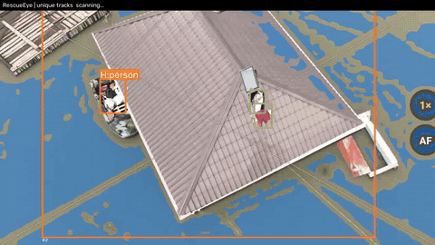<br>
<sub>Open-vocabulary teacher + ByteTrack + water segmentation on a real flood video (Oleshky, Ukraine, June 2023 -
CC BY 4.0, see credits). People on the roof and in the boat are flagged HIGH (next to water); blue tint = segmented
water.</sub></p>

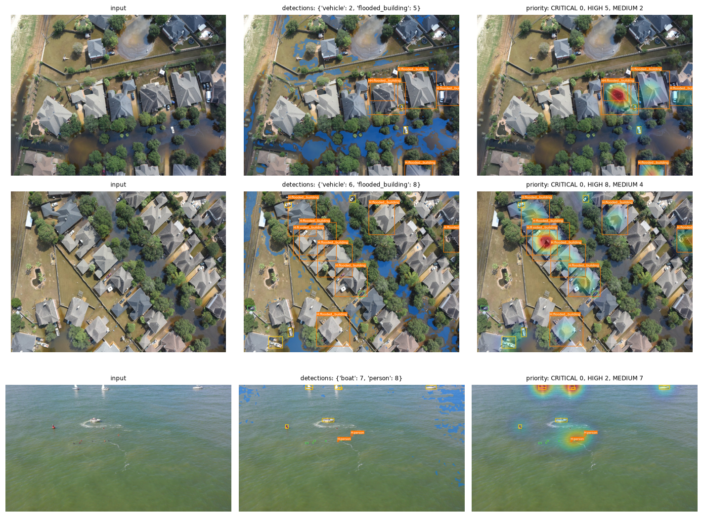

---

## Why this problem

* Floods are the most common disaster on Earth: **44% of all disaster events in 2000-2019, affecting 1.6 billion
  people** (UNDRR & CRED, *The Human Cost of Disasters 2000-2019*) [1].
* In Pakistan's 2022 floods **33 million people** were affected and **1,739 died** (Government of Pakistan PDNA, 2022) [2].
* After Hurricane Harvey (2017), the event FloodNet was recorded in, NOAA estimated about **US$125 billion** in damage [3].

Drones are cheap and fly under the clouds, but a human cannot watch hours of footage, objects are tiny (a swimmer is often
< 20 px), and every disaster looks different from the training data. That is exactly the setting where
**zero-shot open-vocabulary detection**, **slicing for tiny objects** and **label-efficient distillation** matter.

## Research questions

1. **Zero-shot transfer.** How well do open-vocabulary detectors (YOLO-World, OWLv2, Grounding DINO) work on aerial
   rescue imagery with only text prompts? Which words work ("person" vs "swimmer" vs "person in water")?
2. **Tiny objects.** Does slicing-aided inference (SAHI) help, and is it better than simply feeding a higher resolution?
3. **Distillation under a tiny label budget.** Can a 2.6 M-parameter YOLO11n *student* trained on the teacher's
   pseudo-labels match a supervised model, with 0 / 1% / 10% / 100% of the labels? Does a closed-set model trained on one
   source transfer to another disaster?
4. **Surrogate-assisted tuning.** With only ~50 evaluations, can a Gaussian-process surrogate + evolutionary infill
   (SAEA) tune the teacher's pseudo-labelling pipeline better than a genetic algorithm or random search?

## What it does

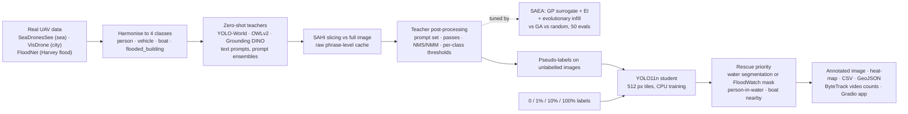

| Component | Where |
|---|---|
| Data download + harmonisation (FloodNet pulled from a 12.8 GB zip with HTTP range requests; masks -> boxes) | `src/rescueeye/data.py` |
| Open-vocabulary detectors with **per-phrase scores** (multi-label NMS for YOLO-World so phrases do not compete) | `detectors.py` |
| SAHI slicing, NMS and greedy non-maximum merging (re-implemented to cache raw slices) | `slicing.py`, `cache.py` |
| COCO evaluation per source (AP50, AP50-95, AP30, small-object AP/recall), hard-label P/R/F1 | `evaluate.py` |
| Zero-shot benchmark and prompt ablation | `zeroshot.py` |
| Surrogate-assisted evolutionary optimisation vs GA vs random search, significance tests, hold-out check | `surrogate.py`, `tune.py` |
| Tiling, students (supervised / distilled), sliced student inference | `tiles.py`, `students.py` |
| Flood-water segmenter (gradient boosting on colour/texture, trained on FloodNet masks) | `water.py` |
| Rescue priority, heat-map, CSV/GeoJSON | `rescue.py` |
| Video: ByteTrack, unique counts, GIF/MP4 | `video.py` |
| CLI (`python -m rescueeye ...`), Gradio app | `cli.py`, `predict.py`, `app/app.py` |

## Data

| Source | What | Licence | Pool (train) | Test |
|---|---|---|---|---|
| **SeaDronesSee** Object Detection v2 [4] | swimmers, boats from UAVs over open water | CC0 (HF mirror `dronefreak/SeaDronesSee`) | 360 images (official train) | 60 images, 288 objects (official val) |
| **VisDrone2019-DET** [5] | pedestrians, cars, trucks... over Chinese cities | research use, per the VisDrone terms | 360 images (official val) | 60 images, 2,094 objects (official test-dev) |
| **FloodNet** Track 1 [6] | UAV images after Hurricane Harvey, pixel masks | CDLA-Permissive-1.0 (HF `torchgeo/floodnet`) | 120 labelled images | 79 labelled images, 389 objects |

* All images are stored with a 1920 px long side. Classes are mapped to **person, vehicle, boat, flooded_building**, and
  each source is evaluated **only on the classes it annotates** (SeaDronesSee: person, boat; VisDrone: person, vehicle;
  FloodNet: vehicle, flooded_building). VisDrone ignore regions and two/three-wheelers are treated as "ignore".
* FloodNet only has semantic masks, so boxes are connected components of `building-flooded` and `vehicle` masks. Test
  sets are random seeded subsets so that the transformer teachers fit the CPU budget (`scripts/make_test_subset.py`).
* **Label budgets** are nested, stratified subsets of the 840-image pool: 1% = 9 images, 10% = 84 images
  (`configs/label_budgets.json`).

**Data audit (an honest finding).** FloodNet's masks are visibly offset from the image content (roofs vs building
polygons, cars vs vehicle blobs) and adjacent houses merge into one component. Box metrics on FloodNet are therefore a
lower bound, which is why AP at IoU 0.3 is also reported.

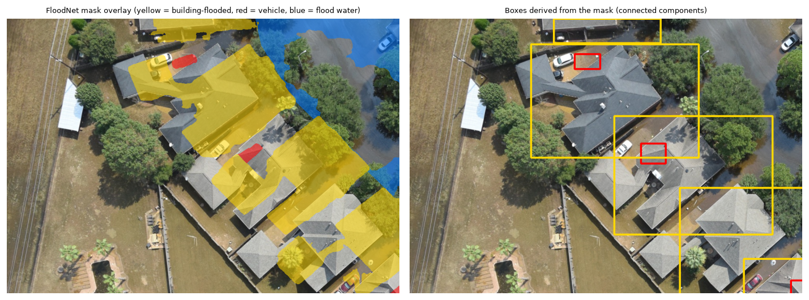

## Results

All numbers are on the held-out test images, CPU only (8 threads, Intel Xeon VM), single run unless stated.
"mean" = average of the three sources (each source weighted equally).

### 1. Zero-shot open-vocabulary detection (no training)

| Detector | Inference | Prompts | SeaDronesSee AP50 | VisDrone AP50 | FloodNet AP50 | **mean AP50** | small-object recall (Sea / City) | s / image |
|---|---|---|---|---|---|---|---|---|
| YOLO-World-v2-S | full image, 640 | class names | 0.463 | 0.248 | 0.027 | 0.246 | 0.36 / 0.19 | **0.04** |
| YOLO-World-v2-S | full image, 1280 | class names | 0.556 | 0.404 | 0.030 | 0.330 | 0.56 / 0.44 | 0.10 |
| YOLO-World-v2-S | SAHI 640 slices | class names | 0.565 | 0.419 | 0.024 | 0.336 | 0.70 / 0.51 | 0.55 |
| YOLO-World-v2-S | full + SAHI 480, NMS | class names | **0.583** | 0.423 | 0.029 | 0.345 | 0.73 / 0.52 | 0.63 |
| YOLO-World-v2-S | full + SAHI 640, *SAHI-default NMM* | class names | 0.414 | 0.330 | 0.022 | 0.255 | 0.59 / 0.40 | 0.58 |
| OWLv2-B/16 | full image | class names | 0.562 | 0.512 | 0.044 | 0.373 | 0.74 / 0.60 | 1.33 |
| **OWLv2-B/16** | full image | **prompt ensemble** | **0.699** | **0.536** | 0.036 | **0.423** | **0.79 / 0.60** | 1.33 |
| Grounding-DINO-T | full image | class names | 0.324 | 0.414 | 0.048 | 0.262 | 0.44 / 0.51 | 2.99 |
| Grounding-DINO-T | full image | prompt ensemble | 0.378 | 0.402 | 0.049 | 0.276 | 0.48 / 0.50 | 2.99 |

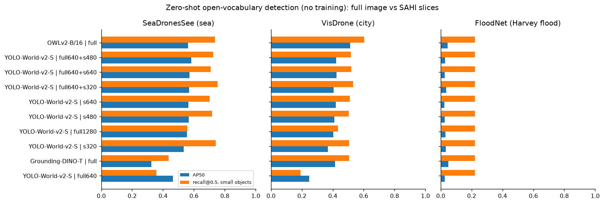

* **Slicing helps tiny objects a lot**: YOLO-World small-object recall on the sea goes from 0.36 to 0.73 and mean AP50 rises
  by 40% relative (0.246 to 0.345).
* **But a simple control gets most of it**: running the same model at 1280 px instead of 640 px reaches 0.330 at a
  sixth of SAHI's cost. Higher input resolution should always be the baseline SAHI is compared against.
* **SAHI's default merge (greedy NMM) hurts** on dense scenes (0.255 vs 0.341): merging fuses neighbouring cars and
  swimmers into one box.
* **Zero-shot fails on flooded buildings** (AP50 < 0.05 for every model): "flooded house" is a *state*, not an object
  category these models learnt, and it must be told apart from dry houses next to it. This is where labels are needed.

**Prompt ablation (AP50, full-image pass).** Words matter, and the best word depends on the scene:

| Detector, prompt for *person* | Sea: person | City: person |
|---|---|---|
| OWLv2, "person" | 0.207 | 0.331 |
| OWLv2, "swimmer" | **0.492** | 0.003 |
| OWLv2, ensemble (person, swimmer, person in water, people; max score) | 0.466 | **0.339** |
| YOLO-World, "person" | 0.211 | 0.173 |
| YOLO-World, "swimmer" | 0.010 | 0.000 |

"Swimmer" more than doubles OWLv2's AP50 for people at sea but destroys it on land. YOLO-World does not understand "swimmer" at
all. A prompt **ensemble** is the robust choice. Full table: `outputs/results/prompt_ablation.csv`.

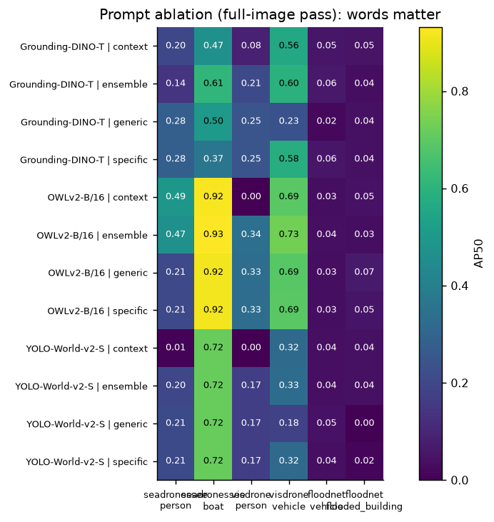

### 2. Distillation into a CPU real-time student

YOLO11n (2.6 M parameters, COCO-pretrained) fine-tuned on 512 px tiles. Every run has the **same budget: at most 600
tiles and about 6,000 training samples** (4-9 min of CPU training each). Pseudo-labels come from YOLO-World (the
only teacher fast enough to label the whole 840-image pool on a CPU in minutes).

| Student | Labels used | Sea AP50 | City AP50 | FloodNet AP50 (AP30) | **mean AP50** |
|---|---|---|---|---|---|
| supervised | 1% (9 images) | 0.470 | 0.168 | 0.025 (0.055) | 0.221 |
| **distilled from teacher** | **0** | 0.612 | 0.400 | 0.040 (0.079) | **0.351** |
| supervised | 10% (84 images) | 0.713 | 0.379 | 0.106 (0.202) | 0.399 |
| **distilled + 10% labels** | 10% (84) + pseudo | 0.688 | 0.412 | 0.108 (**0.232**) | **0.402** |
| supervised | 100% (840 images) | 0.724 | 0.415 | 0.085 (0.198) | 0.408 |
| supervised on VisDrone only | 360 city images | 0.059 | **0.494** | 0.049 (0.064) | 0.201 |

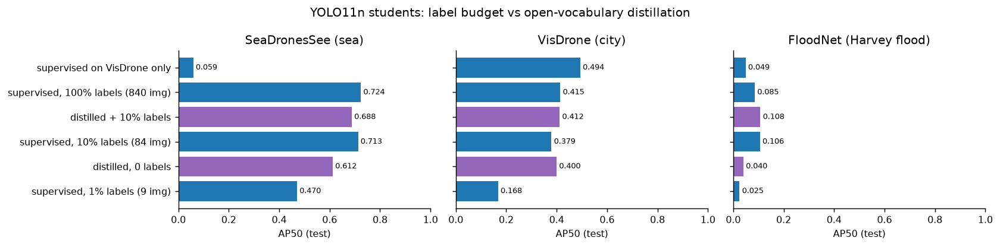

* **With zero labels, the student beats its own teacher.** The YOLO-World pipeline it learnt from scores 0.255 mean AP50;
  the student trained on its pseudo-labels scores 0.351 (+38%) and is ~4x faster. Training on many noisy pseudo-boxes
  denoises them.
* **Zero labels beat 9 labels by a wide margin** (0.351 vs 0.221) and the 0-label student even beats the 84-label
  student on the city set (0.400 vs 0.379).
* **10% labels + pseudo-labels ≈ 100% labels** (0.402 vs 0.408) under the same compute budget.
* **Closed-set supervision does not transfer across disasters.** A detector trained only on city drone images is the best
  on cities (0.494) but collapses at sea (0.059 vs 0.612 for the 0-label distilled student). This is the strongest
  argument for open-vocabulary teachers in disaster response: the next flood will not look like your training set.
* Speed: **0.14 s per 1920 px image** for the student (sliced 512 px tiles + one full 1024 px pass; ~13 ms per tile),
  vs 1.33 s for OWLv2 and 2.99 s for Grounding DINO.

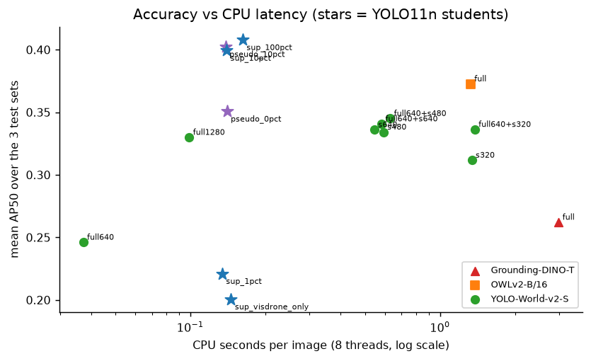

### 3. Surrogate-assisted tuning of the teacher (link to SAEA research)

Search space (9-D, mixed): prompt set (4), inference passes (7 combinations of full/sliced), NMS vs NMM, merge
threshold, four per-class confidence thresholds, minimum box size. Objective: macro F1 of the hard pseudo-labels on the
84 labelled images (the 10% budget), i.e. exactly what the student learns from. Raw detections are cached, so the
evaluation count is the budget being compared.

| Method (50 evaluations, 10 seeds) | best F1 on tuning set | F1 of that config on held-out test |
|---|---|---|
| Random search | 0.396 ± 0.011 | 0.377 |
| Genetic algorithm | **0.408** ± 0.015 | 0.381 |
| **SAEA** (GP Matérn-5/2 + EI, evolutionary infill) | 0.407 ± **0.011** | **0.382** |

* SAEA beats random search (one-sided Wilcoxon signed-rank over seeds, p = 0.042) and **ties** the genetic algorithm
  (p = 0.69), with lower variance across seeds. In a second study with 30 evaluations and 20 seeds all three were within
  0.003 (not significant; SAEA again had the lowest spread, std 0.008 vs 0.013-0.017). Honest reading: on this fairly
  smooth, cheap landscape the surrogate's advantage is reliability, not a higher peak.
* The tuned configuration (prompt ensemble, single **1280 px** pass, NMM 0.71, per-class thresholds) raises pseudo-label
  F1 on held-out test from **0.357 to 0.380** while being **~6x cheaper** than the default SAHI recipe (0.10 vs 0.58 s per
  image). Configs: `configs/teacher.json`, traces: `outputs/results/saea*/`.

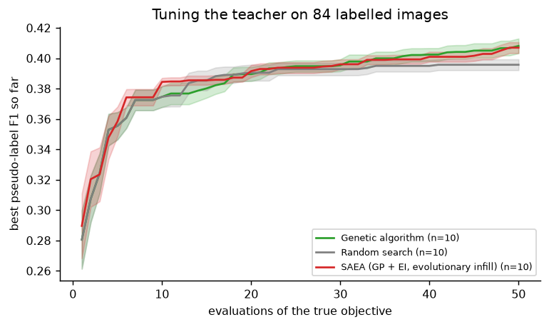

### 4. Rescue outputs

* **Water segmentation** (gradient-boosted pixel classifier, 120 FloodNet images, 1.5 MB model): water IoU **0.48** on the
  FloodNet test set (0.38 on flooded scenes, limited partly by the mask offsets above). Any external mask, for example a
  FloodWatch flood map, can replace it.
* **Priority rule** (transparent, editable): person in water with no boat nearby = CRITICAL; person in/near water = HIGH;
  vehicle in water or flooded building = HIGH; boat = MEDIUM; dry = LOW. Output: annotated image, heat-map,
  `*_detections.csv`, `*_priority.geojson` (pixel coordinates, or lon/lat with `--geo lat,lon,gsd`), `*_summary.json`.
* **Video**: ByteTrack on top of the detector gives one ID per object, so the report says *how many distinct* people were
  seen instead of summing per-frame boxes. Results on the two Commons videos (`outputs/video/*_summary.json`, no ground
  truth, so these are qualitative):
  * *Oleshky* (teacher, 60 frames at 5 fps): people on the roof and in the rescue boat are detected and flagged HIGH,
    but tracks that survive >= 3 frames are only `person 1, boat 1, flooded_building 1` - three people are visible, so
    ByteTrack under-counts when the camera rotates fast and detections flicker.
  * *Aqqala* (60 frames at 2 fps, oblique view): the teacher tracks 12 flooded buildings but misses the cars on the
    road; the 10 %-label student (`aqqala_flood_student_summary.json`) finds the cars but also labels oblique-view
    houses as vehicles (11 "vehicle" tracks). Both students and teacher were tuned on near-nadir imagery, and the
    water segmenter (trained on FloodNet) does not recognise the brown, silt-laden water here, so it is not used for
    this clip. See limitations.

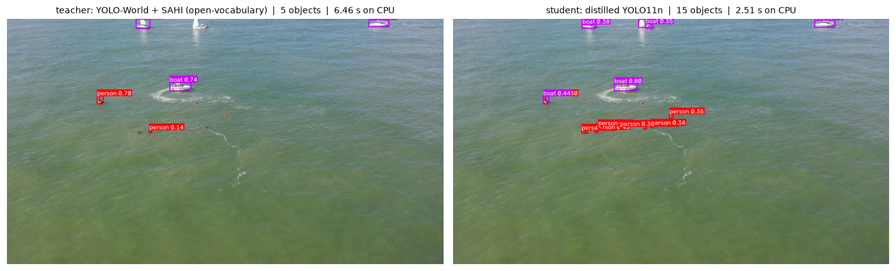

<p align="center">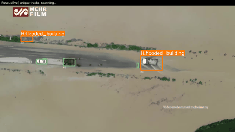<br>
<sub>Flooded town of Aqqala, Iran, 2019 (CC BY 4.0, Mohammad Moheimany / Mehr) - open-vocabulary teacher + tracking;
flooded buildings found, road vehicles missed.</sub></p>

## Quick start

```bash
python -m venv .venv && source .venv/bin/activate
pip install torch torchvision --index-url https://download.pytorch.org/whl/cpu
pip install -r requirements.txt && pip install -e .

# your own images: student (fast) or open-vocabulary teacher with any words
python -m rescueeye predict app/examples/*.jpg --engine student --water auto
python -m rescueeye predict my_drone.jpg --engine teacher --prompt "person, boat, flooded_building=house in water, cow"
python -m rescueeye predict my_drone.jpg --water floodwatch_mask.png --geo 26.7,67.8,0.05   # FloodWatch mask + GeoJSON

# video: track and count each person once
python -m rescueeye video flood.mp4 --engine teacher --fps 4 --duration 30 --water

# demo
python app/app.py

# everything from scratch (downloads ~3 GB, ~2-3 h on 8 CPU cores)
bash scripts/reproduce.sh
python -m pytest -q
```

> CPU tip: run one heavy PyTorch job at a time. Two processes sharing the same cores oversubscribe threads and were
> measured to be up to ~50x slower here.

## Limitations

* Small, seeded test subsets (60 / 60 / 79 images) to fit transformer teachers on a CPU; differences of 1-2 AP points
  are within noise. Students are single-seed runs.
* FloodNet boxes come from spatially offset masks (see audit), so its numbers are lower bounds. No source has people
  annotated *in flood water on land*: "person in flood" is evaluated through SeaDronesSee (open water) only.
* The teacher used for pseudo-labels is YOLO-World, not the stronger OWLv2, because OWLv2 would need ~20 CPU-minutes to
  label the pool; distilling OWLv2 is the obvious next step. SAHI was not run for OWLv2/Grounding DINO for the same
  reason.
* Training and tuning data are near-nadir. On oblique video the student confuses houses with vehicles and the teacher
  misses road vehicles; the water segmenter (IoU 0.48 on FloodNet) fails on brown, silt-laden water. Video counts
  have no ground truth and ByteTrack under-counts under fast camera rotation.
* The priority rule is a heuristic, not a validated triage model, and GeoJSON coordinates assume a nadir, north-up image.
* VisDrone images are not redistributed; check each dataset licence before reuse. Not an operational rescue tool -
  always keep a human in the loop.

## Credits and references

1. UNDRR & CRED (2020). *The Human Cost of Disasters: An overview of the last 20 years (2000-2019).*
2. Government of Pakistan, ADB, EU, UNDP, World Bank (2022). *Pakistan Floods 2022: Post-Disaster Needs Assessment.*
3. Blake, E. S., Zelinsky, D. A. (2018). *Hurricane Harvey (AL092017) Tropical Cyclone Report.* NOAA National Hurricane Center.
4. Varga, L. A., Kiefer, B., Messmer, M., Zell, A. (2022). *SeaDronesSee: A Maritime Benchmark for Detecting Humans in Open Water.* WACV.
5. Zhu, P. et al. (2021). *Detection and Tracking Meet Drones Challenge.* IEEE TPAMI (VisDrone).
6. Rahnemoonfar, M. et al. (2021). *FloodNet: A High Resolution Aerial Imagery Dataset for Post Flood Scene Understanding.* IEEE Access.
7. Cheng, T. et al. (2024). *YOLO-World: Real-Time Open-Vocabulary Object Detection.* CVPR.
8. Minderer, M., Gritsenko, A., Houlsby, N. (2023). *Scaling Open-Vocabulary Object Detection* (OWLv2). NeurIPS.
9. Liu, S. et al. (2024). *Grounding DINO: Marrying DINO with Grounded Pre-Training for Open-Set Object Detection.* ECCV.
10. Akyon, F. C., Altinuc, S. O., Temizel, A. (2022). *Slicing Aided Hyper Inference and Fine-tuning for Small Object Detection.* ICIP.
11. Zhang, Y. et al. (2022). *ByteTrack: Multi-Object Tracking by Associating Every Detection Box.* ECCV.
12. Jin, Y. (2011). *Surrogate-assisted evolutionary computation: Recent advances and future challenges.* Swarm and Evolutionary Computation. Jones, D. R., Schonlau, M., Welch, W. J. (1998). *Efficient global optimization of expensive black-box functions.* J. Global Optimization.
13. Jocher, G. et al. *Ultralytics YOLO* (YOLO11, YOLO-World implementation). Hugging Face *transformers* (OWLv2, Grounding DINO).

Videos (Wikimedia Commons): *Flooded Oleshky, 2023-06-07* - Ministry of Internal Affairs of Ukraine, CC BY 4.0;
*Aerial video of the aftermath of the flood in Aqqala* - Mohammad Moheimany (Mehr News Agency), CC BY 4.0. Clips are
processed (resized, annotated); output GIFs/MP4s are shared under the same licence.

## Author

**Arslan Ali**, AI Engineer, Pakistan · [github.com/arslanali-tech](https://github.com/arslanali-tech)

Research and portfolio prototype. MIT licence (code). Data and video licences as listed above.
